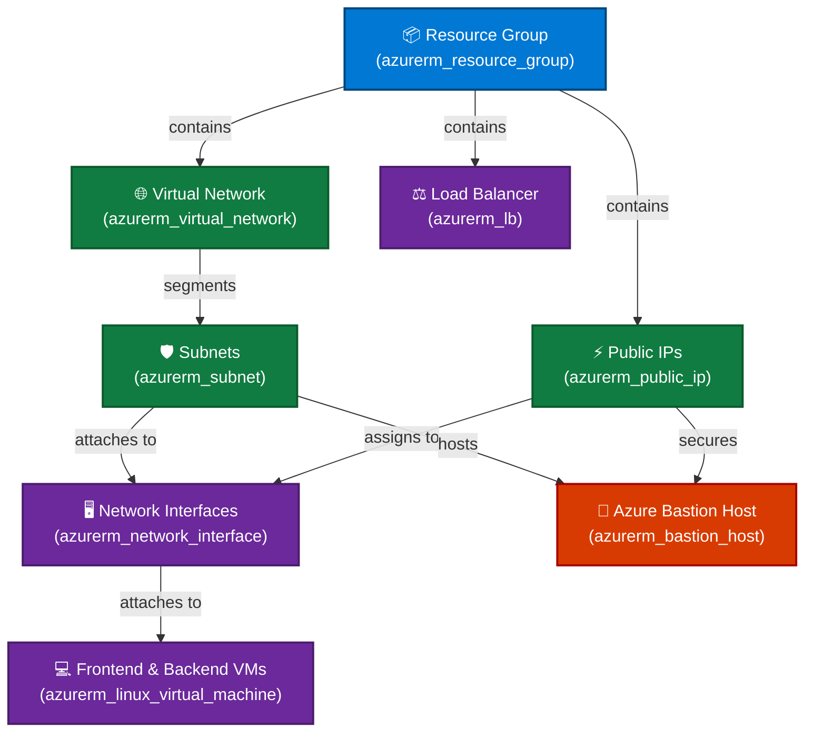

<div align="center">

<!-- Animated Header Banner -->


<br/>

<!-- Animated Typing Tagline -->
<a href="https://github.com/Nirmal9741/az-monolithic-lz">
  
</a>

<p align="center">
  <b>A robust, modular, and scalable Terraform Landing Zone engineered for Microsoft Azure cloud deployments.</b>
</p>

<!-- Shields / Badges -->
<p align="center">
  
  
  
  
  
  
</p>

<p align="center">
  <a href="#-architecture-overview">Architecture</a> •
  <a href="#-key-features">Features</a> •
  <a href="#-repository-structure">Structure</a> •
  <a href="#-quick-start">Quick Start</a> •
  <a href="#-variable-configuration">Configuration</a> •
  <a href="#-infrastructure-components">Components</a>
</p>

---

</div>

## 📑 Table of Contents

- [🌟 Overview](#-overview)
- [🏛️ Architecture Overview](#-architecture-overview)
- [✨ Key Features](#-key-features)
- [📂 Repository Structure](#-repository-structure)
- [🚀 Quick Start](#-quick-start)
  - [Prerequisites](#prerequisites)
  - [Step-by-Step Deployment](#step-by-step-deployment)
- [⚙️ Variable Configuration](#-variable-configuration)
- [🧱 Infrastructure Components](#-infrastructure-components)
- [🛡️ Security Best Practices](#-security-best-practices)
- [🤝 Contributing](#-contributing)
- [📄 License](#-license)

---

## 🌟 Overview

The **Azure Monolithic Landing Zone (`az-monolithic-lz`)** provides an enterprise-ready foundation for hosting workloads in Microsoft Azure. Designed with HashiCorp Terraform, it emphasizes modularity, separation of concerns, and clean dependency management.

Whether provisioning resources for development, staging, or production environments, this landing zone encapsulates core cloud essentials:
- **Foundational Governance**: Dedicated resource grouping and network zoning.
- **Enterprise Networking**: Virtual Networks, address segmentation, and subnetting.
- **Resilient Connectivity**: Azure Public IPs, dynamic NIC allocation, and Load Balancing.
- **Zero-Trust Access**: Fully integrated Azure Bastion Host for secure, agentless administrative access without public exposure.

---

## 🏛️ Architecture Overview

The following diagram illustrates the dependency flow and resource relationships orchestrated by the monolithic landing zone module:



---

## ✨ Key Features

| Feature | Description | Icon |
| :--- | :--- | :---: |
| **Modular Design** | Decoupled submodules under `environments/dev/` driven by a unified orchestrator. | 🧩 |
| **Dynamic Iteration** | Utilizes Terraform `for_each` maps to provision multiple resources predictably. | 🔁 |
| **Strict Ordering** | Enforces resource sequence using explicit `depends_on` relationships. | 📐 |
| **Compute Tier** | Provision multiple Linux VMs (frontend & backend) mapped dynamically to dedicated NICs. | 💻 |
| **Zero-Trust Perimeter** | Bastion-enabled architecture eliminating open RDP/SSH ports on public internet. | 🔒 |
| **Scalable Traffic Distribution** | Integrated Azure Load Balancer ready to balance inbound traffic. | ⚖️ |
| **Remote State Backend** | Azure Blob Storage backend (`azurerm`) for shared, locked, and secure state management. | 📦 |
| **Infrastructure as Code** | 100% reproducible, version-controlled cloud infrastructure. | ⚡ |

---

## 📂 Repository Structure

```text
az-monolithic-lz/
├── 📁 environments/
│   └── 📁 dev/
│       ├── 📁 azurerm_bastion_host/          # Azure Bastion deployment module
│       │   ├── data.tf                      # Subnet & Public IP data lookups
│       │   ├── main.tf                      # Bastion resource definition
│       │   └── variables.tf
│       ├── 📁 azurerm_lb/                    # Azure Load Balancer module
│       │   ├── main.tf
│       │   └── variables.tf
│       ├── 📁 azurerm_linux_virtual_machine/ # Frontend & Backend VM module
│       │   ├── data.tf                      # NIC data lookups
│       │   ├── main.tf                      # Linux VM definitions
│       │   └── variables.tf
│       ├── 📁 azurerm_network_interface/     # NIC provisioning with IP config
│       │   ├── data.tf
│       │   ├── main.tf
│       │   └── variables.tf
│       ├── 📁 azurerm_public_ip/            # Static / Dynamic Public IPs
│       │   ├── main.tf
│       │   └── variables.tf
│       ├── 📁 azurerm_resource_group/       # Core Resource Groups
│       │   ├── main.tf
│       │   └── variables.tf
│       ├── 📁 azurerm_subnet/               # VNet subnets & address prefixes
│       │   ├── main.tf
│       │   └── variables.tf
│       └── 📁 azurerm_virtual_network/      # Virtual Network topologies
│           ├── main.tf
│           └── variables.tf
├── 📁 modules/
│   ├── main.tf                              # Root orchestration module
│   ├── provider.tf                          # AzureRM provider & remote backend
│   └── terraform.tfvars                     # Complete configuration template
├── .gitignore                               # Terraform ignore patterns
└── README.md                                # Project documentation
```

---

## 🚀 Quick Start

### Prerequisites

Ensure you have the following CLI tools installed and authenticated:

- [Terraform](https://developer.hashicorp.com/terraform/downloads) `>= 1.5.0`
- [Azure CLI (`az`)](https://learn.microsoft.com/en-us/cli/azure/install-azure-cli) `>= 2.50.0`
- An active **Microsoft Azure Subscription** with Contributor or Owner rights.

### Step-by-Step Deployment

#### 1. Clone the Repository
```bash
git clone https://github.com/Nirmal9741/az-monolithic-lz.git
cd az-monolithic-lz/modules
```

#### 2. Log in to Azure
```bash
az login
az account set --subscription "<YOUR_SUBSCRIPTION_ID_OR_NAME>"
```

#### 3. Initialize Terraform
Initialize the provider plugins and working state:
```bash
terraform init
```

#### 4. Review Execution Plan
Generate and inspect an execution plan before making changes:
```bash
terraform plan -var-file="terraform.tfvars"
```

#### 5. Apply the Infrastructure
Deploy the complete landing zone to Azure:
```bash
terraform apply -var-file="terraform.tfvars" -auto-approve
```

#### 6. Clean Up / Destroy
When testing is complete, destroy all provisioned resources cleanly:
```bash
terraform destroy -var-file="terraform.tfvars"
```

---

## ⚙️ Variable Configuration

Create a `terraform.tfvars` file inside the `modules/` directory to configure your deployment:

<details>
<summary><b>👉 Click here to view a complete sample <code>terraform.tfvars</code></b></summary>

```hcl
# Resource Groups
resource_groups = {
  rg1 = {
    name     = "dev-rg"
    location = "East US"
  }
}

# Virtual Networks
virtual_networks = {
  vnet1 = {
    name                = "dev-vnet"
    resource_group_name = "dev-rg"
    location            = "East US"
    address_space       = ["10.0.0.0/16"]
  }
}

# Subnets
subnets = {
  subnet_frontend = {
    name                 = "frontend-subnet"
    resource_group_name  = "dev-rg"
    virtual_network_name = "dev-vnet"
    address_prefixes     = ["10.0.1.0/24"]
  }
  subnet_bastion = {
    name                 = "AzureBastionSubnet"
    resource_group_name  = "dev-rg"
    virtual_network_name = "dev-vnet"
    address_prefixes     = ["10.0.2.0/26"]
  }
}

# Public IPs
public_ips = {
  pip_vm = {
    name                = "VM-pip"
    resource_group_name = "dev-rg"
    location            = "East US"
    allocation_method   = "Static"
  }
  pip_bastion = {
    name                = "bastion-pip"
    resource_group_name = "dev-rg"
    location            = "East US"
    allocation_method   = "Static"
  }
}

# Network Interfaces
network_interfaces = {
  frontend_nic = {
    name                = "frontend-nic"
    resource_group_name = "dev-rg"
    location            = "East US"
  }
  backend_nic = {
    name                = "backend-nic"
    resource_group_name = "dev-rg"
    location            = "East US"
  }
}

# Load Balancers
load_balancers = {
  lb1 = {
    name                = "dev-external-lb"
    resource_group_name = "dev-rg"
    location            = "East US"
  }
}

# Bastion Hosts
bastion_hosts = {
  bastion1 = {
    name                = "dev-bastion"
    resource_group_name = "dev-rg"
    location            = "East US"
  }
}

# Virtual Machines (Frontend & Backend VMs)
virtual_machines = {
  frontend_vm = {
    name                = "frontend-vm"
    resource_group_name = "dev-rg"
    location            = "East US"
    size                = "Standard_B1s"
    admin_username      = "azureuser"
    admin_password      = "AzureDevOps2026!"
    nic_name            = "frontend-nic"
  }
  backend_vm = {
    name                = "backend-vm"
    resource_group_name = "dev-rg"
    location            = "East US"
    size                = "Standard_B1s"
    admin_username      = "azureuser"
    admin_password      = "AzureDevOps2026!"
    nic_name            = "backend-nic"
  }
}
```

</details>

---

## 🧱 Infrastructure Components

```
📦 Dev Landing Zone
│
├── 🌐 Networking Tier
│   ├── azurerm_virtual_network       : Core hub address space
│   ├── azurerm_subnet                : Segmentation (Frontend & AzureBastionSubnet)
│   └── azurerm_public_ip             : Static ingress points
│
├── 🛡️ Compute & Interface Tier
│   ├── azurerm_network_interface     : Dynamic private addressing + Public binding
│   └── azurerm_linux_virtual_machine : Frontend & Backend Linux Virtual Machines
│
├── ⚖️ Traffic Distribution
│   └── azurerm_lb                    : Resilient service balancing
│
└── 🏰 Perimeter Security
    └── azurerm_bastion_host          : Web-based RDP/SSH tunnel over TLS (Port 443)
```

---

## 🛡️ Security Best Practices

- [x] **Zero Direct Management Ports**: Virtual machines do not need open `22` (SSH) or `3389` (RDP) on the public internet. Use the deployed Azure Bastion instead.
- [x] **Subnet Separation**: Always isolate workloads into dedicated subnets with appropriate Network Security Groups (NSGs).
- [x] **State Security**: Store Terraform state in a remote Azure Blob Storage container with encryption at rest and state locking enabled.
- [x] **Principle of Least Privilege**: Run deployments via an Azure Service Principal or Managed Identity with scoped RBAC roles.

---

## 🤝 Contributing

Contributions, issues, and feature requests are welcome!

1. **Fork** the repository
2. **Create** your feature branch (`git checkout -b feature/AmazingFeature`)
3. **Commit** your changes (`git commit -m 'feat: Add support for NSG module'`)
4. **Push** to the branch (`git push origin feature/AmazingFeature`)
5. **Open** a Pull Request

---

## 📄 License

This project is licensed under the **MIT License** - see the [LICENSE](LICENSE) file for details.

---

<div align="center">

<!-- Animated Footer Wave -->


<p align="center">
  Built with ❤️ for Cloud & DevOps Engineers
</p>

</div>
